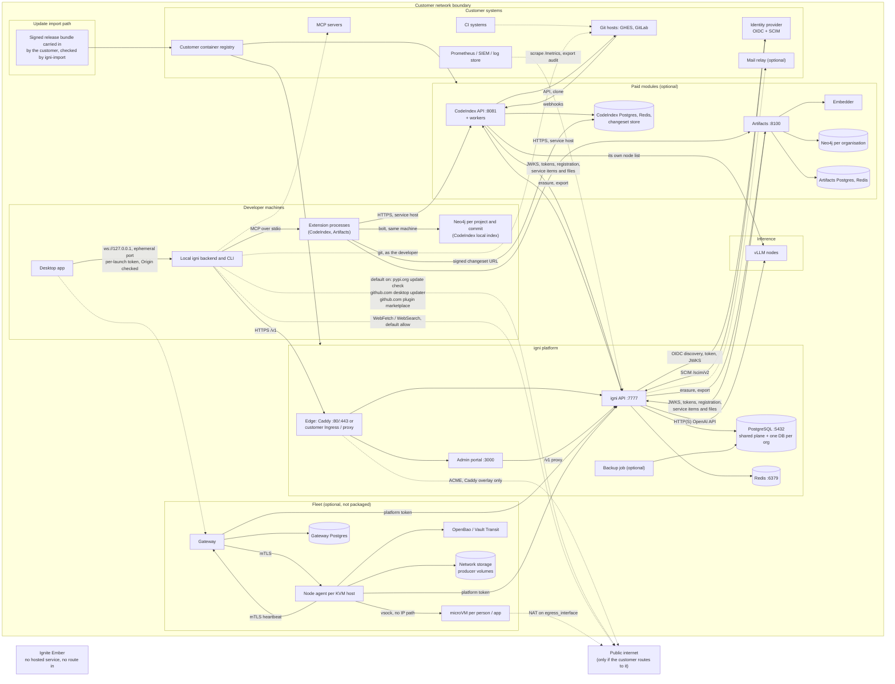

# igni network diagram

For the customer's security team. It describes every network flow in an
igni deployment as the repositories show it on 30 October 2026, and marks
what could not be verified.

igni is software. Ignite Ember is the company that publishes it. Ignite
Ember hosts no part of a deployment and has no route into one.

Sources: this repository (`docs/`, `containers/`, `charts/igni/`,
`app/config.py`, `tests/test_nothing_phones_home.py`), the client
repository `igni`, the CodeIndex repository `igni__code-index`, the
documents service `igni__artifacts`, and the Fleet repository
`igni__cloudvm` (gateway and node agent). A port appears below only where
a file in one of those repositories states it.

## Components

| Component | Where it runs | Repository | Packaged for customers |
|---|---|---|---|
| Desktop app and CLI | Developer machines | `igni` | Desktop installers; the CLI as a Python package |
| igni API and admin portal | Customer servers or Kubernetes | `igni-server` | Compose (`containers/docker-compose.prod.yml`) and Helm (`charts/igni`) |
| PostgreSQL, Redis | Customer, external or bundled | | Bundled under the compose `bundled` profile; external with Helm |
| Inference nodes (vLLM, OpenAI-compatible) | Customer GPUs, on-premises or rented | Customer-run | Not packaged by igni |
| CodeIndex (paid module) | Customer servers | `igni__code-index` | Signed image in the release bundle; local-development compose only, no deployment manifest |
| Artifacts, documents (paid module) | Customer servers | `igni__artifacts` | Signed images (API, embedder) in the release bundle. Not deployed by `charts/igni`; the chart only routes to it |
| Fleet: gateway, node agents, microVMs | Customer bare-metal KVM hosts | `igni__cloudvm` | Not packaged (see Gaps) |

## 1. Diagram

Solid lines are flows a working deployment needs. Dotted lines are
optional flows that exist only when the customer configures them, or that
are on by default and can be switched off (marked "default on").



Plain-text version of the same picture:

```
+------------------------------- CUSTOMER NETWORK -------------------------------+
|                                                                                |
|  DEVELOPER MACHINES                         igni PLATFORM                      |
|  +------------------------------+          +--------------------------------+  |
|  | Desktop app                  |          | Edge: Caddy 80/443 or Ingress  |  |
|  |   | ws://127.0.0.1:<ephem.>  |  HTTPS   |   |-> igni API :7777           |  |
|  | Local backend / CLI ---------+--------->|   |-> Portal :3000             |  |
|  |   | MCP stdio                |          | API -> PostgreSQL :5432        |  |
|  | Extension processes          |          | API -> Redis :6379             |  |
|  |   | bolt (same machine)      |          | Backup job -> PostgreSQL       |  |
|  | Neo4j per project+commit     |          +--------------------------------+  |
|  +------------------------------+             |  HTTP(S)          ^  ^  ^      |
|        | HTTPS (service hosts)                v                   |  |  |      |
|        v                                 +-----------+            |  |  |      |
|  PAID MODULES (optional)                 | vLLM GPU  |<-- CodeIndex  |  |      |
|  +------------------------------+        | nodes     |               |  |      |
|  | CodeIndex :8081 + workers    |        +-----------+               |  |      |
|  |   -> Postgres, Redis,        |-- JWKS/tokens/items/files ---------+  |      |
|  |      changeset store         |<- erasure/export (from API)           |      |
|  | Artifacts :8100              |                                       |      |
|  |   -> Postgres, Redis,        |                                       |      |
|  |      embedder, Neo4j per org |                                       |      |
|  +------------------------------+                                       |      |
|        ^ webhooks     | API, clone                                      |      |
|        |              v                                                 |      |
|  CUSTOMER SYSTEMS                                                       |      |
|  Git hosts (GHES, GitLab), CI      Identity provider --SCIM------------>+      |
|  MCP servers                       API --OIDC--> identity provider             |
|  Prometheus / SIEM (pull)          API --SMTP--> mail relay (optional)         |
|  Container registry <-- release artefacts carried in by the customer           |
|                                                                                |
|  FLEET (optional, not packaged)                                                |
|  Client --WSS--> Gateway --mTLS--> Node agent --vsock--> microVM               |
|  Gateway -> own Postgres;  Node agent -> OpenBao/Vault, network storage        |
|  Gateway, node agent --platform token--> igni API                              |
|  microVM --NAT on egress_interface--> whatever that interface reaches          |
+--------------------------------------------------------------------------------+
         : optional / default-on outbound, only if a route exists
         v
   Public internet (pypi.org, github.com, web tools, ACME, VM egress)

   Ignite Ember: no hosted service, no inbound path, no outbound path to it
```

## 2. Network flows

Direction is from the side that opens the connection. "Configurable"
means the address and port come from customer configuration and no value
is fixed in the repositories.

### Developer machines

| # | Source | Destination | Protocol / port | Purpose | Required |
|---|---|---|---|---|---|
| D1 | Desktop app | Local backend on the same machine | WebSocket, `ws://127.0.0.1`, ephemeral port (`--ws-port 0`). Loopback only. At the handshake the backend refuses (403) a browser `Origin` that is not the app's own (`tauri://localhost`, `http(s)://tauri.localhost`, loopback pages) and any connection without the per-launch token the app generated for it (32 random bytes, passed to the backend in its environment and offered by the webview as the subprotocol `igni-token.<token>`). See igni `docs/SECURITY.md` §10 | UI to agent | Required |
| D2 | Local backend / CLI | igni API via edge | HTTPS; 443 with the Caddy overlay, otherwise configurable (`api_url`) | Sign-in, chat completions, models, notifications, group policy, extension download; while a person is signed in, pulling the messages, files and events services sent them (D14) | Required |
| D3 | Browser on developer machine | 127.0.0.1 callback listener | HTTP, port not fixed in the repo | CLI sign-in callback | Required for CLI sign-in |
| D4 | CodeIndex and Artifacts extension processes | CodeIndex / Artifacts service hostnames | HTTPS, configurable | Module features, with a token issued by igni API | Optional (paid modules) |
| D5 | CodeIndex extension | Changeset store via signed URL | HTTPS; CodeIndex itself, or the configured S3/GCS endpoint | Download changesets for the local index | Optional |
| D6 | CodeIndex extension | Neo4j it starts on the same machine | Bolt, port not fixed in the repo | Local code index, one per project and commit | Optional |
| D7 | Local backend | MCP servers | stdio (local process) or SSE URL, configurable | Customer-chosen tools | Optional |
| D8 | Agent shell and git tools | Customer git remotes | Whatever the developer's git is configured to use | Git operations run as the developer | Optional |
| D9 | Local backend | `pypi.org` | HTTPS 443 | Update check. **On by default** (`update_check_ttl: 86400`); `update_check_ttl: 0` or `air_gapped: true` turns it off | Optional, default on |
| D10 | Desktop app (Tauri updater) | `github.com/ignite-ember/igni/releases` | HTTPS 443 | Desktop update check. **On by default**; `update_check_ttl: 0` turns it off, `update_endpoint` points it at a customer HTTPS mirror, and under `air_gapped: true` the app asks only that mirror, or nothing. Signature key fixed in `tauri.conf.json` | Optional, default on |
| D11 | Local backend | `github.com/anthropics/claude-plugins-official` | HTTPS 443 (git clone) | Plugin marketplace registered and refreshed at session start. **On by default**; `plugins.default_marketplace: false` or `air_gapped: true` turns it off | Default on |
| D12 | Agent `WebFetch` tool | Any URL the model requests | HTTP(S) | Web fetch. **Allowed by default** | Optional |
| D13 | Agent `WebSearch` tool | DuckDuckGo via `ddgs` | HTTPS | Web search. Only when the `web` extra is installed; asks for confirmation | Optional |
| D14 | Local backend | igni API `POST /v1/me/events/pull`, `POST /v1/me/events/ack`, `GET /v1/me/events/{event_id}/attachments/{attachment_id}` | HTTPS via edge, the person's own session | Fetch the person's pending service items (messages, chats, actions, events) and the files named by them, then acknowledge each. An event no extension handler took is acknowledged `not_handled` | Optional (a service with an extension the person has on) |
| D15 | Local backend / CLI | Customer OpenTelemetry collector | OTLP over HTTP(S) (`/v1/traces`, `/v1/metrics`) or gRPC, configurable (`telemetry.otlp.endpoint` in managed settings or group policy, or `OTEL_EXPORTER_OTLP_ENDPOINT`) | Traces and metrics of agent runs, model calls and tool calls. **Off by default; no default endpoint.** A user's or a project's config cannot set it; under `air_gapped: true` a collector outside the network is refused. No prompt, response, file content or tool argument unless `capture_content: true`. Outgoing requests carry `traceparent` | Optional |

D12 and D13 are disabled by `--no-web`, by `permissions.web_search: deny`
and `permissions.web_fetch: deny` in `~/.igni/config.yaml`, by
`air_gapped: true`, or by an organisation's group policy publishing any of
these settings.

### igni platform

| # | Source | Destination | Protocol / port | Purpose | Required |
|---|---|---|---|---|---|
| P1 | Clients, browsers | Edge (Caddy overlay) | TCP 80 (redirect) and 443 on all interfaces | TLS termination; `/v1/*` and `/.well-known/*` to API, rest to portal | Required (or customer Ingress/proxy) |
| P2 | Edge | igni API | HTTP 7777 on the internal network | API | Required |
| P3 | Edge | Portal | HTTP 3000 on the internal network | Admin UI | Required |
| P4 | Portal (nginx) | igni API | HTTP 7777 | `/v1` proxy for browser traffic | Required |
| P5 | igni API, migration job, backup job | PostgreSQL | TCP 5432 (default, configurable) | All persistent state | Required |
| P6 | igni API | Redis | TCP 6379 (default, configurable) | Concurrency leases, one-time codes, node registry | Required |
| P7 | igni API | Inference nodes | HTTP(S) to each node's `base_url` (example in docs: 8000), configurable | Chat completions, `/v1/models` probe, `/metrics` scrape | Required |
| P7a | igni API | A cloud model provider: Azure OpenAI or Foundry, Vertex AI (`<region>-aiplatform.googleapis.com`), Bedrock (`bedrock-runtime.<region>.amazonaws.com`), `api.anthropic.com` | HTTPS 443 | Chat completions and Messages for a backend of a cloud `kind`. **Only when an operator configures one; none by default.** Region pinned per backend | Optional |
| P7b | igni API | The cloud's identity endpoints: instance metadata (`169.254.169.254`), AWS STS, Google OAuth, Microsoft Entra ID | HTTPS 443 (metadata: HTTP) | Tokens and keys for a cloud backend's auth method — the server's own identity, an assumed role or impersonated account, or a stored credential. Only for a cloud backend | Optional |
| P8 | GPU start/stop automation | igni API `/v1/nodes` | HTTPS via edge | Register, heartbeat, deregister nodes. Endpoint returns 404 unless `NODE_REGISTRATION_TOKEN` is set | Optional |
| P9 | igni API | Customer OIDC provider | HTTPS, configurable; `https` enforced outside dev | Discovery, token exchange, JWKS | Optional (required for SSO) |
| P10 | Customer identity provider | igni API `/scim/v2` | HTTPS via edge | User provisioning and deprovisioning. 503 unless `SCIM_TOKEN` is set | Optional |
| P11 | igni API | Mail relay or Amazon SES API | SMTP 587 (`starttls`), 465 (`tls`) or 25 (`none`); or HTTPS to SES | Sign-in codes, invitations. **Off by default** (`email_enabled=false`) | Optional |
| P12 | igni API | `accounts.google.com`, `oauth2.googleapis.com`, `www.googleapis.com` | HTTPS 443 | Google sign-in. Inactive unless a Google client id and secret are set | Optional |
| P13 | Customer Prometheus | igni API `/metrics` | HTTP 7777 | Metrics. 404 unless `METRICS_TOKEN` is set | Optional |
| P14 | Customer SIEM | igni API `/v1/portal/audit-events/export` | HTTPS via edge | Pull the audit trail (JSON Lines) | Optional |
| P15 | Caddy | Let's Encrypt ACME | HTTPS 443 outbound, plus inbound 80 for the challenge | Certificate issue and renewal. Only with `docker-compose.tls.yml`; not usable air-gapped | Optional |
| P16 | igni API | Customer OpenTelemetry collector | OTLP over HTTP(S) (`/v1/traces`) or gRPC, `OTEL_EXPORTER_OTLP_ENDPOINT` | Traces of requests, outgoing calls and SQL statements. **Off by default; no default endpoint**; set only from the environment. No request body, query string or caller address. Outgoing calls (P7, M2) carry `traceparent` | Optional |

`/docs` and `/openapi.json` are served only inside the network and are not
routed by Caddy or the Ingress.

### Paid modules

| # | Source | Destination | Protocol / port | Purpose | Required |
|---|---|---|---|---|---|
| M1 | CodeIndex, Artifacts | igni API | HTTPS to `PUBLIC_BASE_URL`, or in-cluster Service (Helm) | Discovery, JWKS, registration, tokens (`private_key_jwt`), extension upload, directory, notifications | Required for each module |
| M2 | igni API | CodeIndex, Artifacts | HTTPS to each service's registered URL | `DELETE`/`GET /v1/igni/subjects/...` (erasure, subject access), organisation deletion | Required for each module |
| M3 | GHES, GitLab | CodeIndex `/v1/webhooks/github`, `/v1/webhooks/gitlab` | HTTPS, CodeIndex hostname | Push events, signature-verified | Optional |
| M4 | CodeIndex workers | GHES, GitLab | HTTPS, host per registered GitHub App / GitLab integration | API calls and repository clone | Required for CodeIndex |
| M5 | CodeIndex API and workers | Their own PostgreSQL, Redis | 5432, 6379 (defaults) | State, Celery broker | Required for CodeIndex |
| M6 | CodeIndex | Changeset store | Filesystem (default), S3-compatible or GCS, configurable | Changeset storage | Required for CodeIndex |
| M7 | CodeIndex | Inference nodes (`codeindex` pool) | HTTP(S), configurable | Indexing | Required for CodeIndex |
| M8 | Artifacts | Its PostgreSQL, Redis | Configurable (`POSTGRES_URL`, `REDIS_URL`) | State | Required for Artifacts |
| M9 | Artifacts | Embedder | HTTP, `EMBEDDER_URL`; 7001 in local compose only | Document embeddings | Required for search |
| M10 | Artifacts | Neo4j, one per organisation | Bolt, address entered by a super admin; port not fixed in the repo | Document graph | Required for Artifacts |
| M11 | Any approved service (CodeIndex, Artifacts, or one the customer or its integrator built) | igni API `POST /v1/service-items`, `POST /v1/service-events`, `POST /v1/service-attachments` | HTTPS, the service's own token | Messages, new chats and actions for a person's or an app's agent, and events for the service's own extension. An item may name a chat by the service's own thread key and carry up to 10 files of at most 5 MiB each. Only what the service's extension declares in `permissions.service` is accepted. Kept in the organisation's own database until delivered or expired (`docs/service-identity.md` §15) | Optional |
| M12 | Any approved service | igni API `GET /v1/service-events`, `GET /v1/service-events/{event_id}` | HTTPS, the service's own token | Read what became of each item it sent: delivered, `not_handled`, expired, dropped or failed | Optional |

Service listening ports: CodeIndex 8081 (`containers/be/Dockerfile`),
Artifacts 8100 (`charts/igni/values.yaml`, `artifacts.servicePort`). Each
module is served on its own hostname, never under igni's.

### Fleet (microVM per person or app)

| # | Source | Destination | Protocol / port | Purpose | Required |
|---|---|---|---|---|---|
| F1 | Client (person or app) | Gateway public listener | WSS and HTTPS, `[public] listen`, configurable | Connect to the producer's VM, sign-in, commands | Required for Fleet |
| F2 | Gateway | Node agent API | HTTP/1.1 over mutual TLS, configurable; also a unix socket for a co-located gateway | ensure-running, suspend, streams, commands | Required for Fleet |
| F3 | Node agent | Gateway nodes listener | Mutual TLS, `[nodes] listen`, configurable | Registration, heartbeat | Required for Fleet |
| F4 | Gateway | Its PostgreSQL | Configurable (`[database] url`) | Placement, leases, jobs, audit | Required for Fleet |
| F5 | Gateway, node agent | igni API | HTTPS, platform token (`private_key_jwt`) | Producer feed, wakes, VM profiles, commands, exports; the gateway pulls each producer's service items and files and acknowledges them, `not_handled` for an event no extension took | Required for Fleet |
| F6 | Node agent | microVM | vsock; igni's WebSocket inside the VM on 8765 (default) | Stream relay, guest agent | Required for Fleet |
| F7 | Node agent | OpenBao / Vault Transit | HTTPS, configurable | Wrap and unwrap per-producer data keys | Required for Fleet (`transit` provider) |
| F8 | Node agent host | Network storage for `volumes_dir` | Per the mount (NFS in the benchmarks) | Producer volumes | Required for Fleet |
| F9 | Node agent | PostgreSQL (admin login) | Configurable | Create per-producer database roles | Required for Fleet |
| F10 | Node agent | S3-compatible object store | HTTPS or HTTP, configurable | Offload of long-suspended producers | Optional |
| F11 | Gateway | Autoscaling webhook | Configurable | Scale-out and idle signals | Optional |
| F12 | microVM guest | `network.egress = "internet"`: whatever `network.egress_interface` routes to. `"internal"` (the default with `air_gapped = true`): only `network.allow` | NAT; `network.allow` accepted first, then RFC 1918, link-local, CGNAT and metadata ranges dropped; under `internal`, everything else dropped | Package installs, git, tools run by the agent in the VM; igni API, modules, PostgreSQL and inference via `network.allow` | Required config item |

### Update import path

| # | Source | Destination | Protocol / port | Purpose | Required |
|---|---|---|---|---|---|
| U1 | Customer operator | Customer container registry | Customer's transfer method, then the registry protocol from the import host (`skopeo`) | One signed tarball per release (images, Helm chart, SBOMs), verified offline by `igni-import` with the customer's copy of the cosign public key, the same one that verifies the images, then pushed by digest; desktop installers separately. See [OFFLINE_UPDATES.md](OFFLINE_UPDATES.md). The chart and compose files have no default registry and refuse to start without an explicit image and tag | Required for install and update |
| U2 | Customer cluster or hosts | Customer container registry | Registry protocol, configurable | Image pull | Required |
| U3 | CodeIndex, Artifacts | igni API `PUT /v1/clients/{id}/extension` | HTTPS | Upload the extension bundle and its assets, signed (JWS) with the service's registered key | Required for each module |
| U4 | Local backend | igni API `/v1/extensions` | HTTPS | Download approved extensions and the assets for its platform | Required for each module |

## 3. What crosses the boundary

**From the server side, nothing at runtime.** The igni API, portal,
CodeIndex and Artifacts make no call to Ignite Ember. Every host named in
`igni-server/app` is on an allow-list in
`tests/test_nothing_phones_home.py`, each with a reason: Google sign-in
(inactive unless configured) and example hosts. The same test fails the
build if a telemetry or error-reporting package enters `uv.lock` or the
portal's `package.json`, and checks that any analytics tag in the portal
would only load on the vendor's own marketing hostname (`ignite-ember.sh`).
The portal carries none today: the marketing site and its analytics moved
to a separate repository on 2026-10-31. A self-hosted portal opens on
`/dashboard`; its sidebar links to the documentation at
`https://ignite-ember.sh/docs`, which an air-gapped network will not reach.
The client, CodeIndex and Artifacts each have their own copy of the test.

Those scans check source and dependency files. A second, runtime test in
each repo (`tests/test_*reaches_nothing_outside_the_network.py`, and
`crates/gateway/tests/egress.rs` for Fleet) runs the real service and fails
on any connection or lookup outside the network. In the Python repos every
test runs under the same guard (`tests/egress_guard.py`).

**The only inbound artefact is the release the customer carries in:** a
signed bundle of container images, the Helm chart and SBOMs, plus desktop
installers. `igni-import` checks the bundle's signature and
every file's hash with no network, then pushes the images to the customer's
own registry with their cosign signatures intact; the customer installs on
its own schedule. Extension bundles reach developer machines from the customer's
own igni API, signed by the service that uploaded them.

**Outbound flows the customer must switch off for an air-gapped install.**
These exist in the code today and are on by default. On the client one
switch turns all of them off: **`air_gapped: true`** in `~/.igni/config.yaml`,
in the managed-settings file (which a user cannot override), or in a group
policy's settings, or `IGNI_AIR_GAPPED=1` in the environment
(`igni` `docs/CONFIGURATION.md`, "Air-gapped mode"). On Fleet the
switch is `air_gapped = true` in each node agent's `node-agent.toml`.

| Flow | Default | Under the air-gap switch | Its own switch |
|---|---|---|---|
| D9, client update check to `pypi.org` | On | Off | `update_check_ttl: 0` |
| D10, desktop updater to `github.com` | On | Off; asks only `update_endpoint` (a customer mirror), if set | `update_check_ttl: 0`, or `update_endpoint` |
| D11, plugin marketplace clone from `github.com` | On | Off; only local marketplaces and those in `plugins.marketplaces` are fetched, and other plugin or marketplace URLs — including `/plugin update` from a plugin's recorded source — are refused | `plugins.default_marketplace: false` |
| D12, D13, agent web fetch and search | Allowed | Denied; neither tool is built | `--no-web`, `permissions.web_fetch: deny`, `permissions.web_search: deny` |
| `igni ext install <url>`, MCP servers reached by URL, HTTP hooks | Any host | Refused before connecting unless the host is inside the network: loopback, the igni server, `update_endpoint` and plugin-marketplace hosts, or `network.internal_hosts` (which a project's config cannot set) | None |
| What the agent runs as a program: shell commands, MCP servers started as local processes, command hooks | Whatever the network allows | Not covered: the customer's egress rules limit these as they limit any program | Network egress rules |
| Desktop first launch: uv, CPython, `ignite-ember` | On, once | No download: the app runs on `runtime_python` (an interpreter the customer installs from its own mirror), or refuses | `runtime_python` or `IGNI_RUNTIME_PYTHON` |
| Decision model (Laya) from Hugging Face | On first use, if not cached | Loaded only from the local cache with the hub offline; refused if not pre-seeded | None |
| F12, microVM egress | NAT to `egress_interface` | `network.egress = "internal"`: only `network.allow` (igni API, modules, PostgreSQL, inference) | `network.egress = "internal"` |
| P15, Caddy ACME | Only with the TLS overlay | Use the Helm Ingress with a customer certificate, or the customer's own proxy |
| Inference nodes: vLLM's anonymous usage statistics, and a model download when vLLM is given a Hugging Face model id rather than a local path | vLLM's own defaults; igni does not package or configure vLLM | Not covered: the node is the customer's. Set `VLLM_NO_USAGE_STATS=1` and `HF_HUB_OFFLINE=1` on the node and serve from a local path ([MODEL_PROVENANCE.md](MODEL_PROVENANCE.md)) | The same variables |

The Agno framework's own run telemetry (to `os-api.agno.com`) is off in
every client process: `AGNO_TELEMETRY=false` is set before Agno is
imported, every agent and team igni builds passes `telemetry=False`, and
the extension services the client starts are handed the variable
(`igni-core` `src/igni_core/core/agno_telemetry.py`). An explicit
`AGNO_TELEMETRY=true` is honoured outside air-gapped mode and overruled,
with a warning, under it. A runtime test runs agent turns and fails on any
attempt to reach an `agno.com` host
(`test_no_run_reaches_an_agno_host.py` in `igni`).

OpenTelemetry (D15, P16) is not a flow out of the network unless the
customer points it out of the network: there is no default endpoint, the
client takes it only from managed settings, group policy or the
environment, and an air-gapped client refuses a collector outside the
network.

Optional integrations a customer may enable themselves, all pointing at
systems the customer names: OIDC and SCIM, SMTP or Amazon SES, an
OpenTelemetry collector, Google sign-in, git hosts, MCP servers, S3-compatible or GCS object storage, and
any model endpoint a user adds to their own client configuration.

## 4. Data at rest

| Data | Where | Notes |
|---|---|---|
| Source code | Developer working copies; CodeIndex clones and changeset store; Fleet producer volumes | CodeIndex's clone location on disk is not stated in the repo |
| Code index | CodeIndex PostgreSQL and changeset store; a Neo4j store per project and commit on each developer machine, under the extension's data directory | Vectors are computed on the developer machine |
| Documents | Artifacts PostgreSQL and the organisation's Neo4j | Graph passwords encrypted with Fernet (`GRAPH_CREDENTIALS_KEY`) |
| Accounts, memberships, chat usage, notifications | igni PostgreSQL: a shared plane plus one logical database per organisation (`<db>_t<n>`) | |
| Token-signing key and stored secrets | igni PostgreSQL, Fernet-encrypted under `SECRET_ENCRYPTION_KEY` | The key is held outside the database |
| Service items for a person or an app (messages, chat titles, thread keys, event payloads) and their files | igni PostgreSQL, the organisation's own database (`producer_events`, `service_attachments`) | A file is deleted a day after upload if no item names it, otherwise when its item expires. An item is deleted `SERVICE_EVENT_RETENTION_DAYS` (default 30) after it was delivered, expired or dropped |
| Extension bundles and assets | igni PostgreSQL (`service_extensions`), up to 400 MiB per bundle | Included in database backups |
| Audit trail | igni PostgreSQL `audit_events`, append-only by trigger; retention `AUDIT_RETENTION_DAYS` (default 0, keep all) | Also: client `~/.igni/audit.log`, gateway `gw_audit`, node agent local audit |
| Leases, one-time codes, node registry | Redis | Bundled Redis snapshots to the `redisdata` volume |
| Backups | `IGNI_BACKUP_DIR` (compose) or a customer PVC (Helm); one dump per organisation, mode 600 | Off by default with Helm |
| Logs | stdout of each container, collected by the customer | Sign-in codes are written to the log only with `LOG_SIGN_IN_CODES=true` and no mail relay; off by default, warned while on |
| TLS certificates | Caddy `caddy_data` volume, or a Kubernetes Secret | |
| Client configuration and credentials | `~/.igni/` (`config.yaml`, `credentials.json`, update-check cache); per-project `state.db` | |
| Model weights | Inference nodes, managed by the customer | Not handled by igni |
| Fleet volumes | Network storage, one image per producer, dm-crypt `aes-xts-plain64`, key wrapped by OpenBao/Vault Transit | Erasure destroys the Transit key |
| Fleet node-local state | Node NVMe, fscrypt per producer | Shared warm base snapshots are not encrypted and hold no producer data |
| Fleet VM structured state | PostgreSQL, one role per producer incarnation | |

Database and volume encryption for igni's own PostgreSQL and Redis is the
operator's responsibility (`docs/COMPLIANCE.md`, CC6.7).

## 5. Gaps

Points that could not be verified from the repositories, or where the
code differs from the description given to us.

1. **Signed update bundle: built, keys not yet issued.** CD signs each
   igni image with cosign (a Cloud KMS key, reached through GitHub OIDC,
   no transparency log) and attaches its CycloneDX SBOM as a signed
   attestation; on `main` it builds one tarball per release with a MANIFEST
   signed with the same key, and `igni-import`
   verifies and imports it offline ([OFFLINE_UPDATES.md](OFFLINE_UPDATES.md),
   `tools/release/`). The key exists; no release has been signed with it
   yet, so no signed bundle exists until the first one is. The bundle carries igni's
   images only, not the third-party `postgres`, `redis` and `caddy` images
   the chart and compose files use. Also signed: desktop updates (Tauri,
   minisign key) and extension bundles (JWS with the service's key).
2. **What the runtime egress tests cannot see.** All five repos now have
   the source scan and a runtime test. The runtime tests run the app on the
   standard asyncio loop, because the guard cannot observe uvloop, which
   production uses; the hosts called are the same either way. They do not
   see native-code networking or what a child process does once started.
   Fleet's resume path needs a KVM host and has not run. `igni__cloudvm`
   now has CI, which runs its gateway's source scan and egress tests on
   every push; the tests that need a KVM host are still run by hand.
3. **Default-on client egress.** D9, D10 and D11 still run on an
   unconfigured install; an air-gapped one sets `air_gapped: true` (section
   3). D11 has its own switch, `plugins.default_marketplace: false`
   (`igni` `docs/CLOUD.md` §11, item 5, now decided). The switch does
   not cover hosts a user names themselves (model endpoints, MCP servers,
   git remotes).
4. **Fleet is not packaged.** No Helm or compose definitions exist for the
   gateway or node agents (`CLOUD.md` §11, item 7), and node agents
   register with igni API by hand. A guest reaches igni API, its services
   and PostgreSQL through `network.allow` in `node-agent.toml`
   (`igni__cloudvm` `docs/node-agent.md`, Isolation); which addresses to list
   is per deployment and not packaged.
5. **Paid modules have no customer deployment files.** CodeIndex has a
   Dockerfile and a local-development compose file. Artifacts is routed by
   `charts/igni` but deployed separately; no production manifest for it
   was found.
6. **`mcp_gateway_url`** (default `http://mcp_gateway:7778`) is a setting in
   `app/config.py` and in the Helm values, but nothing in `app/` reads it
   and no such service is defined. Its purpose is unclear.
7. **Ports not fixed in the repo:** inference nodes, OIDC provider,
   Neo4j (both uses), gateway and node-agent listeners, OpenBao/Vault,
   network storage, MCP servers, the CLI sign-in callback.
8. **NetworkPolicy** in `charts/igni` is off by default. When on, it denies
   ingress and egress for every pod of the release (API, portal, migrate
   Job, backup CronJob); admits the ingress controller the customer names
   (required) to the API and portal, and the portal to the API; opens DNS
   on port 53 to any destination unless pinned; and has an empty
   per-destination, per-port egress allow-list until the customer fills
   it.
9. **TLS inside the deployment** (edge to API, API to PostgreSQL, Redis and
   inference nodes) is not enforced by the product.
